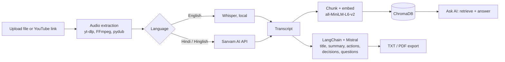

# AI Meeting Intelligence Platform

Turn a meeting recording into a transcript, summary, action items, key decisions and open questions, then ask follow-up questions about the meeting using RAG.

**Live demo:** https://ai-meeting-analytics-1.onrender.com/
(Hosted on a free tier, so the first request may be slow while the service wakes up.)

<!-- Add a demo GIF or 2-3 screenshots here, e.g.:


-->

---

## Features

- **Two input options:** upload an audio/video file, or paste a YouTube link.
- **Transcription:** local OpenAI Whisper for English; Sarvam AI API for Hindi/Hinglish.
- **Structured analysis:** an AI-generated title, summary, action items, key decisions and open questions.
- **Ask AI (RAG):** chat with a meeting. Answers are generated from retrieved transcript chunks stored in ChromaDB.
- **Live progress:** the UI shows which pipeline stage is running (for example, "Transcribing audio (english)...").
- **Export:** download the full report as TXT or PDF.

## Tech stack

| Layer | Tools |
|---|---|
| Backend | Python, FastAPI, Uvicorn |
| Frontend | React, Vite |
| Speech-to-text | OpenAI Whisper (local), Sarvam AI API |
| Audio / video | yt-dlp, FFmpeg, pydub |
| LLM orchestration | LangChain, Mistral |
| RAG | Sentence Transformers (`all-MiniLM-L6-v2`), ChromaDB |
| Export | PDF / TXT report generation |

## How it works



1. The frontend sends the file or link to the FastAPI backend and then polls the meeting's status.
2. The backend extracts and converts the audio, then transcribes it.
3. The transcript goes to the LLM for structured extraction, and in parallel is chunked, embedded and stored in ChromaDB.
4. Questions in the "Ask AI" tab retrieve the most relevant chunks and the LLM answers from them.

## Project structure

```
.
├── backend/
│   ├── app/main.py          # FastAPI app and routes
│   ├── core/                # transcription, LLM, vector store (RAG) logic
│   ├── utils/               # audio processing, report export
│   └── requirements.txt
└── frontend/                # React + Vite UI
```

## Getting started

### Prerequisites

- Python 3.10+ and Node.js 18+
- [FFmpeg](https://ffmpeg.org/download.html) installed and available on your `PATH`
- A Mistral API key and a Sarvam AI API key

### 1. Clone

```bash
git clone https://github.com/SNEHASISHBAGDI/AI-Meeting-Analytics.git
cd AI-Meeting-Analytics
```

### 2. Backend

```bash
cd backend
python -m venv venv
# Windows: venv\Scripts\activate    macOS/Linux: source venv/bin/activate
pip install -r requirements.txt
```

Create `backend/.env`:

```env
MISTRAL_API_KEY=your_mistral_key
SARVAM_API_KEY=your_sarvam_key
```

Start the API:

```bash
uvicorn app.main:app --reload --port 8000
```

Check it at `http://127.0.0.1:8000/health`.

### 3. Frontend

```bash
cd frontend
npm install
npm run dev
```

Open `http://localhost:5173`.

### First-run downloads

The first run downloads models, so it can take a while:

- The Whisper model (about 460 MB) on the first transcription.
- The `all-MiniLM-L6-v2` embedding model on the first RAG request.

## API overview

| Method | Endpoint | Purpose |
|---|---|---|
| GET | `/health` | Service health check |
| GET | `/api/meetings/{id}` | Meeting status and results |
| POST | `/api/meetings/{id}/chat` | Ask a question about a meeting (RAG) |

Interactive docs are available at `/docs` when the backend is running.

## Known limitations

- **Transcription speed:** Whisper runs on CPU (FP32), so long recordings take a while. Speed depends on your machine.
- **Proper nouns:** Whisper can mishear names and product terms. These errors carry into the summary and chat answers.
- **Hindi/Hinglish:** this path depends on the Sarvam AI API, which can time out (HTTP 504) on long audio. It is less tested than the English path.
- **RAG answers:** the LLM can blend information from different parts of a long transcript. Answers are only as good as the retrieved chunks.
- **Hosting:** the live demo runs on a free tier with limited resources, so large files may be slow or fail.

## Roadmap

- Show retrieved transcript chunks (with timestamps) alongside each RAG answer.
- Chunk long audio and retry on upstream timeouts.
- Add a glossary or prompt hint to improve proper-noun accuracy.
- Add tests for extraction and retrieval functions.

## Author

**Snehasish Bagdi**
[GitHub](https://github.com/SNEHASISHBAGDI) · [LinkedIn](https://www.linkedin.com/in/snehasish-bagdi-9b2716323/)
